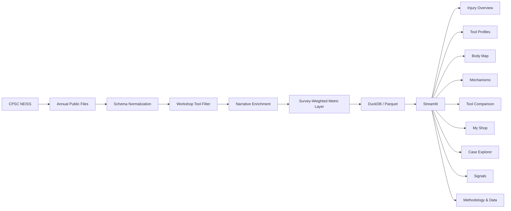

# Workshop Injury Intelligence


[](https://shop-injury-intelligence.streamlit.app/)
[](https://github.com/jameskbb/shop-injury-intelligence/actions/workflows/ci.yml)
[](LICENSE)

Workshop Injury Intelligence turns U.S. Consumer Product Safety Commission emergency-department
data into an interactive view of how workshop tools are associated with injuries, where on the
body those injuries occur, and what the underlying incident narratives reveal.

**[Open the live app](https://shop-injury-intelligence.streamlit.app/)**: nothing to install, no
account, no API key. It covers **2006–2025** and draws on **63,425** sampled ER case records
involving workshop tools, which the app weights into national estimates. Spot a problem?
[Open an issue](https://github.com/jameskbb/shop-injury-intelligence/issues).


Every number in the app is an **estimated count of U.S. ER-treated injuries**, not a rate. NEISS
records who reached an emergency department, not how many people own or use each tool, so the
app shows where injuries concentrate and never ranks tools by "risk". The
[What this does NOT measure](#what-this-does-not-measure) section explains why.

## What problem this solves

Workshop tool injuries are common, but most public information about them is either anecdotal
or locked inside CPSC's raw survey files. This app makes that data navigable for woodworkers and
home-shop users, and keeps it statistically honest. It answers four questions:

- **Which tools** appear most often in estimated ER-treated injuries.
- **Where on the body** those injuries land.
- **How** they happen, mined from the incident narratives.
- **How severe** the ER cases are: diagnosis, hospital admission, and change over time.

## Why NEISS is unusual

The National Electronic Injury Surveillance System (NEISS) is a probability sample of about 100
U.S. hospital emergency departments, chosen to represent every ED in the country by size and
type. Each sampled case carries a survey weight and belongs to a stratum and a primary sampling
unit (the hospital), so a national estimate and its uncertainty come from weighted survey
statistics, not from counting rows. Each case also carries a short free-text narrative of how the
injury happened. This project mines those narratives for tool subtype, mechanism and activity
where the official product code alone is too broad.

## Key capabilities

Each item links to its page in the live app. The [screenshot gallery](#screenshots) shows them
all.

- **[Injury Overview](https://shop-injury-intelligence.streamlit.app/):** national,
  survey-weighted estimates with burden (how often a tool appears) kept visually and
  statistically separate from severity (what those cases look like).
- **[Body Map](https://shop-injury-intelligence.streamlit.app/body-map):** a 3D figure you can
  orbit, zoom and click to filter. Picking a tool dims every region it does not reach, and a Hand
  view closes in on the fingers.
- **[Mechanisms](https://shop-injury-intelligence.streamlit.app/mechanisms):** injury mechanisms
  mined from narratives, and a five-stage tool to disposition pathway.
- **[Tool Profiles](https://shop-injury-intelligence.streamlit.app/tool-profiles)** and
  **[Tool Comparison](https://shop-injury-intelligence.streamlit.app/comparison):** one tool in
  depth, or two to six side by side.
- **[My Shop](https://shop-injury-intelligence.streamlit.app/my-shop):** a profile scoped to the
  tools you own.
- **[Case Explorer](https://shop-injury-intelligence.streamlit.app/case-explorer):** full-text
  search over individual de-identified ER narratives.
- **[Signals](https://shop-injury-intelligence.streamlit.app/signals):** deterministic findings
  under the current filters, each with its comparison baseline and sample size.
- **[Methodology & Data](https://shop-injury-intelligence.streamlit.app/methodology):** the full
  pipeline, validation against CPSC's own figures, data-quality checks and known limitations.

## Architecture



CPSC's archived annual files are downloaded and normalized to one schema across the 2019 NEISS layout change, then filtered to workshop-tool product codes. A
deterministic narrative classifier enriches each case, and a survey-weighted metric layer
aggregates them into Parquet tables that DuckDB queries. The nine Streamlit pages read only those
processed tables, never the raw files.

## Narrative intelligence

A deterministic, rule-based classifier reads each case's narrative and extracts tool subtype,
mechanism, activity, and mentions of protective equipment or guards. No language model runs at
query time, so the public app needs no API key. The classifier only refines or fills in fields
and never overrides an official CPSC product code.

Every in-scope case gets a classifier result (100.0% coverage). Where a narrative does not
support a confident call, the result is an explicit "unknown" rather than a guess; that is the
outcome for the mechanism of 36.3% of cases. Accuracy on a held-out set of 137 hand-labelled
narratives, labelled with AI assistance rather than by trained NEISS coders, is published in
[`docs/classifier_validation.md`](docs/classifier_validation.md), including 70.1% for primary
mechanism.

## Survey-weighted methodology

Estimates use the NEISS sample weights with Taylor-linearized, ultimate-cluster (stratum and PSU)
variance. This is the same approach CPSC's own Query Builder uses. Reconciled against it for
2009, 2014, 2019 and 2024, estimates and sample counts show zero mismatches across 108
single-year product rows (105 compared, 3 not published by CPSC), with coefficients of variation
agreeing to CPSC's rounding and suppression agreeing where CPSC suppresses. Pooled multi-year
periods have not yet been reconciled ([`docs/validation.md`](docs/validation.md)).
Unstable estimates, those with a high coefficient of variation or too few sampled cases, are
suppressed or flagged following CPSC's guidance rather than shown as if reliable. Every figure is
labelled "Estimated U.S. ER-treated injuries" and states whether it is an annual average or a
period total.

## Data source

The pipeline reads the official CPSC NEISS **Archived Annual Data** files directly from
`cpsc.gov`, with no third-party mirrors. The committed release spans **2006–2025** and holds
**63,425** workshop-tool ER cases ([`data/metadata/data_metadata.json`](data/metadata/data_metadata.json)).
NEISS is U.S. public domain data; [`docs/data-distribution.md`](docs/data-distribution.md)
records the size and redistribution basis of the curated Parquet committed here. Downloads use [`curl_cffi`](https://github.com/lexiforest/curl_cffi) because `cpsc.gov`
rejects plain HTTP clients.

## What this does NOT measure

NEISS has no exposure denominator: no count of tool owners and no hours of tool use. An estimated
injury count is therefore **not** a probability of injury. A widely owned tool can generate many
ER cases partly because many people use it, and a rarely owned tool can appear less often simply
because fewer people own it. Nothing in this app should be read as "tool X is more hazardous than
tool Y", only as "tool X is associated with more (or fewer) estimated ER cases than tool Y".

NEISS is also not a workplace injury system. It generally excludes injuries already covered by
occupational reporting, so this project is not, and does not claim to be, a workplace injury dataset.

## Limitations

- **Burden, not risk.** With no exposure denominator, counts cannot become per-use rates.
- **Narrative fields are approximate.** Mechanism, activity and equipment mentions come from
  short ER notes; some cases stay unclassified rather than guessed.
- **The 2019 coding change.** Some fields, such as a secondary body part, are only reliably
  populated from 2019 onward, and pages that depend on them say so.
- **Emergency departments only.** Injuries treated at urgent care, by a doctor's office or at
  home are outside NEISS by design.
- **Browser coverage.** The app is checked in desktop and phone-width Chromium; Safari and
  physical devices are not yet verified. See [`docs/known-issues.md`](docs/known-issues.md).

## Running locally

The [live app](https://shop-injury-intelligence.streamlit.app/) is the quickest way in. To run
it yourself you need Python 3.13 and [uv](https://docs.astral.sh/uv/):

```bash
git clone https://github.com/jameskbb/shop-injury-intelligence.git
cd shop-injury-intelligence
uv sync --locked --python 3.13
uv run --locked streamlit run app.py
```

The processed data are committed, so the app starts without downloads, a database server or API
keys. [`docs/deployment.md`](docs/deployment.md) covers the hosted Streamlit Community Cloud
setup (including the reboot the live app needs after a push), self-hosting, health checks and a
browser smoke checklist.

## Refreshing data

`scripts/sync_neiss.py` downloads, caches and re-processes the annual files. Raw `.tsv` files are
cached under `data/raw/` and never committed; curated Parquet and QA reports land in
`data/processed/` and `data/metadata/`, which are committed.

```bash
# Detect the latest published year and process the 20-year window ending there.
uv run python scripts/sync_neiss.py --latest

# Process a specific inclusive year range, downloading any missing years.
uv run python scripts/sync_neiss.py --years 2019:2025

# Re-download years even if already cached locally.
uv run python scripts/sync_neiss.py --latest --refresh

# Never touch the network: process only what is already in data/raw/.
uv run python scripts/sync_neiss.py --offline --years 2019:2025

# Report the latest available year and whether local data is current, without processing.
uv run python scripts/sync_neiss.py --check-latest
```

With no flags, the CLI detects the latest year (unless `--offline`), downloads any missing years
of the default 20-year window, and processes that window together with any other years already in
`data/raw/`.

| Exit code | Meaning |
|------|---------|
| 0 | Success (or, for `--check-latest`, local data is current) |
| 1 | A structural QA check failed; see `data/metadata/qa_report.md` |
| 2 | Usage error, such as an incompatible flag combination |
| 3 | A year could not be downloaded and no local file exists; see manual placement below |
| 4 | Latest-year detection failed (dropdown and probe fallback both unreachable) |
| 10 | (`--check-latest` only) a newer year is available than what is processed locally |

**If a download is blocked** (a network outage or an Akamai change), download the file yourself
from `https://www.cpsc.gov/cgibin/NEISSQuery/Data/Archived%20Data/{YEAR}/neiss{YEAR}.tsv`, save
it as `data/raw/neiss{YEAR}.tsv`, and rerun with `--offline`.

**Automated refresh.** [`refresh-data.yml`](.github/workflows/refresh-data.yml) runs monthly and
on demand. When data are current it logs that and stops. When CPSC publishes a new year it runs
the full sync, QA, classifier validation and both test suites, then opens a pull request with the
regenerated data; it never pushes to `main` directly. That pull request does not start CI on
its own, so run [CI](.github/workflows/ci.yml) on its branch manually before merging.

## Testing

```bash
uv run pytest -q
```

Unit tests run entirely on synthetic fixtures and never touch the network; an autouse fixture
fails any test that opens a socket. A separate opt-in suite reconciles the pipeline against real,
locally cached NEISS files and the official CPSC Query Builder figures. It needs
`data/raw/neiss{YEAR}.tsv` present and never downloads:

```bash
uv run pytest -m realdata -q
```

[`docs/testing.md`](docs/testing.md) traces the core statistical, data and classifier behaviours
to specific test ids, and a test fails if any cited test is renamed or removed. CI runs lint,
formatting and the synthetic suite on every push and pull request to `main`.
Contributors changing a page re-shoot its screenshots in the same change; see
[`docs/testing.md`](docs/testing.md#screenshots).

## Technology

| Layer | Choice | Why |
| --- | --- | --- |
| Runtime | Python 3.13 | Managed end to end by `uv`, with a committed `uv.lock` so CI, local runs and the hosted app resolve identically. |
| Ingestion | `curl_cffi` 0.16 | cpsc.gov returns 403 to plain HTTP clients; browser-TLS impersonation retrieves the official annual files. |
| Transformation | Polars 1.44 | One-pass ingest and enrichment over ~7M raw rows with predictable memory use. |
| Storage | Parquet | The curated tables are 4.4 MB, committed, so the app needs no data setup and no database service. |
| Query layer | DuckDB 1.5 | Analytical SQL over the Parquet tables, including the survey-weighted variance pass, with no server to run. |
| Statistics | `scipy` + hand-rolled Taylor linearization | Stratified ultimate-cluster variance from stratum, PSU and weight: a short closed-form formula the project tests directly, rather than a survey-statistics dependency. |
| Application | Streamlit 1.63 | `st.navigation` routing, `st.cache_data` throughout, and a custom light drafting theme. |
| Charts | Plotly 6 | Native Sankey and selection events wired through Streamlit. The body map is a Three.js figure (an `st.components.v2` component) with a hand-authored SVG fallback. |
| Quality | ruff 0.16, pytest 8 | Lint, format and the synthetic suite run on every push and pull request to `main`. |

Plotly and pandas are pinned below their newest major versions; see
[`pyproject.toml`](pyproject.toml).

## Screenshots

All nine pages, captured at 1440px wide. Every page is also captured at phone width (390px);
the gallery shows the three where the layout changes most. Each page is titled with the question
it answers.

### 1. Injury Overview

**What sends workshop users to the ER?** ([open](https://shop-injury-intelligence.streamlit.app/))

Six headline figures, the burden-vs-severity landscape that keeps "how often" separate from "how
bad", a tool-by-year heatmap, and insight cards generated from calculated facts, never written by
a model.


### 2. Tool Profiles

**What does one tool's injury pattern look like?** ([open](https://shop-injury-intelligence.streamlit.app/tool-profiles))

One tool in depth: the body regions it involves, its trend over time with confidence bands, its
diagnosis and mechanism mix, and real de-identified narratives behind the numbers.


### 3. Body Map

**Where on the body do workshop injuries happen?** ([open](https://shop-injury-intelligence.streamlit.app/body-map))

A matte 3D figure drawn like a drafting plate. Drag to orbit, scroll or pinch to zoom, and use
**Whole body** or **Hand** to jump between views. Picking a tool fades the regions it does not
reach, holds the figure so the answer reads before anything moves, then turns toward the most
affected area. Hovering never moves the camera.

Two independent channels carry the data. **Ink density is the measure**: a region with more
estimated ER-treated injuries is darker and stands slightly proud of the surface. **Linework is
confidence**: a reportable estimate has no outline, a dashed line marks a limited sample, a dashed
line over bare sheet means the estimate is below the reporting floor, and a faint solid hairline
means no cases were recorded. Hovering shows a region's estimate, sample size and any suppression
label; clicking it filters the diagnosis and mechanism mix, top tools, narratives and the
body-part by tool matrix below.

NEISS records fingers as **one** body-part category. The figure models five fingers, but all five
always share a single value, and the page says so rather than inventing a split.

The 3D view loads Three.js from jsDelivr. Offline, without WebGL, or with the **Flat body map**
toggle on, the page shows a keyboard-accessible front and back 2D map with the same data and the
same click-to-filter behaviour.


### 4. Mechanisms

**How do workshop injuries happen?** ([open](https://shop-injury-intelligence.streamlit.app/mechanisms))

Mechanism categories mined from ER narratives, plus a five-stage Tool → Mechanism → Body →
Diagnosis → Disposition pathway. Flows below the CPSC reportability floor are pooled into an
explicit combined band rather than quietly dropped.


### 5. Tool Comparison

**How do these tools actually differ?** ([open](https://shop-injury-intelligence.streamlit.app/comparison))

Two to six tools side by side. The fingerprint matrix shows each tool's diagnosis and severity
mix as a log-ratio against the all-workshop baseline, so a tool's signature is visible
regardless of how common it is.


### 6. My Shop

**What should I be mindful of in my shop?** ([open](https://shop-injury-intelligence.streamlit.app/my-shop))

Pick the tools you own for a profile scoped to them: the body regions those tools involve most
and what to watch for, stated as associations among ER cases, with the no-exposure-denominator
caveat on every view.


### 7. Case Explorer

**What actually happened in these cases?** ([open](https://shop-injury-intelligence.streamlit.app/case-explorer))

Full-text search across de-identified ER narratives, with matches highlighted and each case's
year, age band, diagnosis and disposition. This is the raw material every mechanism category is
derived from.


### 8. Signals

**What stands out under the current filters?** ([open](https://shop-injury-intelligence.streamlit.app/signals))

Findings that clear the stability and effect-size gates, grouped by kind. Within each kind, cards
are ordered by descriptive difference, not by an evidence or severity score. Every card states
what differs, by how much, against which baseline, and on how many sampled cases.


### 9. Methodology & Data

**How was every number on this site produced?** ([open](https://shop-injury-intelligence.streamlit.app/methodology))

The survey methodology, the reconciliation against CPSC's Query Builder, a data-lineage diagram,
measured classifier accuracy, and a data-quality panel naming every pipeline check that did not
pass.


## Why this exists

The hard problem in this dataset is restraint. A NEISS estimate is a statistical claim with a
variance attached. The data also carry no exposure denominator, so the question every woodworker
arrives with, which tool hurts people at the highest rate, cannot honestly be answered from it.

Building this meant deciding what the product refuses to say, then enforcing those refusals in
code rather than in a disclaimer: burden and severity kept structurally separate, estimates
suppressed or flagged by coefficient of variation at a single call site, comparisons gated on
non-overlapping confidence intervals, and a vocabulary check that fails CI if words like "risk",
"danger" or "safer" reach a user-facing string. The reconciliation against CPSC's Query Builder
exists for the same reason: an estimate nobody checked against the publisher is just a number.

---

Found a wrong number, a broken page or a confusing label?
[Open an issue](https://github.com/jameskbb/shop-injury-intelligence/issues). The code is licensed
under the [MIT License](LICENSE). The NEISS data are U.S. public domain, published by CPSC (see
[`docs/data-distribution.md`](docs/data-distribution.md)).
