# Workshop Injury Intelligence

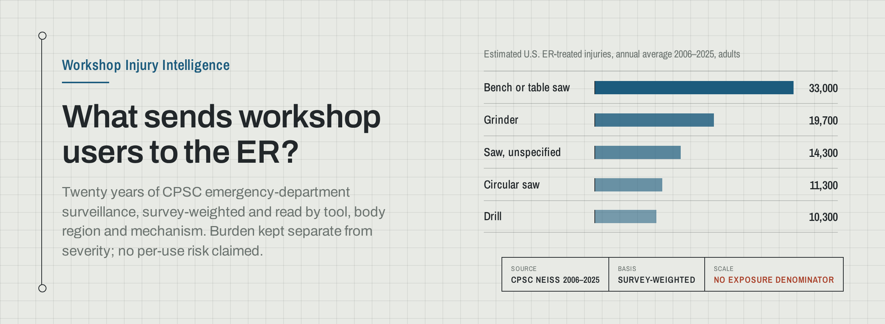

Workshop Injury Intelligence turns U.S. Consumer Product Safety Commission emergency-department
data into an interactive view of how workshop tools are associated with injuries, where on the
body those injuries occur, and what the underlying incident narratives reveal.

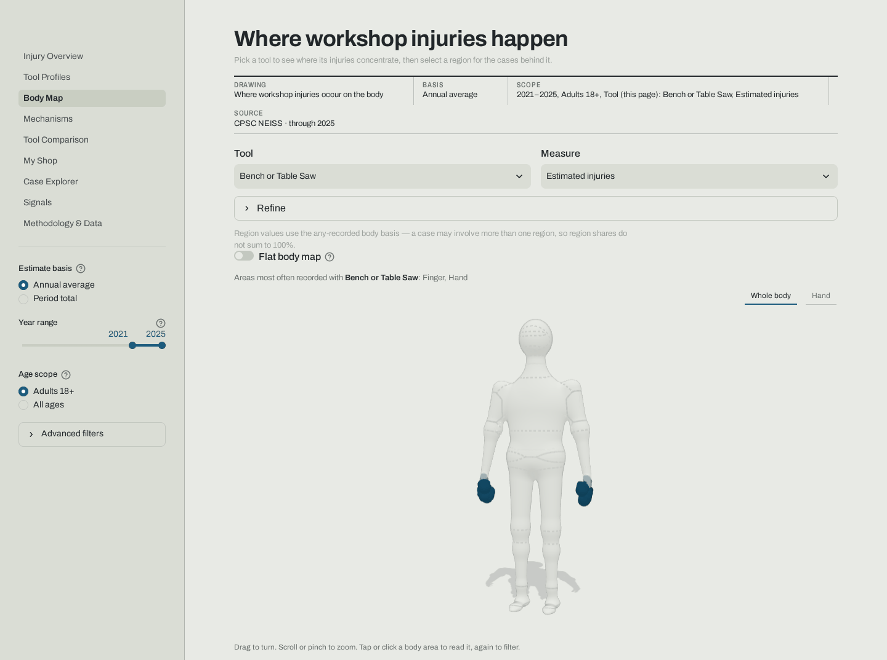

## What problem this solves

Workshop tool injuries are common, but most public data about them is either anecdotal or locked
inside CPSC's raw survey files. This app turns the U.S. Consumer Product Safety Commission's NEISS
emergency-department data into a navigable, statistically honest view: which tools appear most in
ER-treated injuries, where on the body those injuries land, how they happen, and how severe the
ER cases are.

## Why NEISS is unusual

NEISS is a probability sample of roughly 100 hospital emergency departments across the U.S.,
selected to represent the full population of EDs by size and type. Every sampled case carries a
survey weight, and cases are grouped into strata and primary sampling units (PSUs/hospitals);
national estimates and their variance come from Taylor-linearized, weighted survey statistics, not
a raw row count. Case narratives (short, coded free text describing how the injury happened) are
mined for tool subtype, mechanism, and activity when the official product code alone is too broad.

## Key capabilities

- National, survey-weighted estimates of ER-treated workshop-tool injuries, with burden (how often
  a tool appears) kept visually and statistically separate from severity (what those cases look
  like); see [Injury Overview](#screenshots).
- A 3D, interactive body map of where on the body those injuries occur: drag to orbit the figure,
  scroll to zoom, and click a region to filter the page. Picking a tool dims everything that tool
  does not reach, holds the whole figure long enough to read, then leans into its worst area; a
  Hand view closes in on the hand and its five modelled fingers ([Body Map](#screenshots)).
- Narrative-derived injury mechanisms and a five-stage injury pathway ([Mechanisms](#screenshots)).
- Side-by-side tool comparison and a personal "My Shop" profile scoped to the tools you own.
- A searchable case explorer over individual, de-identified ER narratives.
- A ranked Signals feed surfacing the strongest deterministic findings across every tool at
  once, each tier-tagged and carrying its own comparison baseline and sample size.
- A Methodology & Data page documenting the full pipeline, validation, data-quality checks,
  and known limitations.

## Architecture

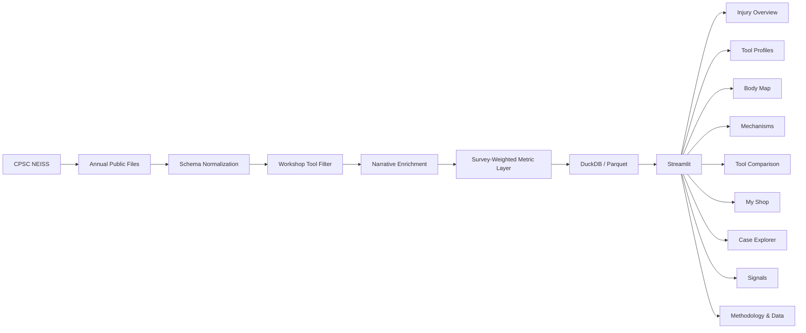

Each stage above is a real pipeline step: CPSC's archived annual files are downloaded, normalized
to a shared schema across the pre/post-2019 NEISS layout, filtered to workshop-tool product codes,
enriched with a deterministic (non-LLM) narrative classifier, aggregated through a survey-weighted
metric layer, cached as DuckDB/Parquet, and served by the nine Streamlit pages above.

## Narrative intelligence

Tool subtype, mechanism, activity, and PPE/guard mentions are extracted from each case's short
incident narrative with a deterministic, rule-based classifier (never an LLM at query time), so
the public app runs with no API key. The classifier only ever refines or fills in fields; it never
overrides an official CPSC product code. Measured coverage and per-field accuracy are recorded in
`data/metadata/classifier_validation.json` and `docs/classifier_validation.md`; the committed
build classifies 100.0% of in-scope workshop cases.

## Survey-weighted methodology

Every displayed estimate is computed from NEISS sample weights using Taylor-linearized,
ultimate-cluster (stratum + PSU) variance, the same approach CPSC's own Query Builder uses,
verified to match it exactly for multiple product codes and years (`docs/validation.md`). Unstable
estimates (high coefficient of variation, or too few sampled cases) are suppressed rather than
shown, per CPSC's own suppression guidance. Every KPI states whether it is an annual average or a
period total, and always as "Estimated U.S. ER-treated injuries"; burden and severity are always
kept visually distinct.

## Data source

The pipeline ingests the official CPSC NEISS **Archived Annual Data** files directly from
`cpsc.gov`: no Kaggle, no unofficial mirrors, no alternate data source. `cpsc.gov` sits behind
Akamai and returns HTTP 403 to plain HTTP clients (`curl`, `requests`); downloads use
[`curl_cffi`](https://github.com/lexiforest/curl_cffi) with `impersonate="chrome"`, which matches
Chrome's TLS/HTTP2 fingerprint closely enough to pass Akamai's edge check. The committed release
currently spans **2006–2025** (latest processed year **2025**), curated to **63,425** workshop-tool
ER cases (`data/metadata/data_metadata.json`). NEISS is U.S. public domain data (data.gov,
`usa.gov/publicdomain/label/1.0`); see
[`docs/data-distribution.md`](docs/data-distribution.md) for the measured size and redistribution
basis for the curated Parquet committed in this repository.

## What this does NOT measure

NEISS has no exposure denominator: no count of tool owners and no hours of tool use. An estimated
injury count is therefore **not** a probability of injury: a widely owned tool can generate many
ER cases partly because many people use it, and a rarely owned tool can appear less often simply
because fewer people own it. Nothing in this app should be read as "tool X is more dangerous than
tool Y", only as "tool X is associated with more (or fewer) estimated ER cases than tool Y."

NEISS's consumer-product-injury surveillance is also not a workplace injury surveillance system:
it generally excludes injuries already covered by occupational reporting systems, so this project
is not, and does not claim to be, an occupational/workplace injury dataset. Stating both
limitations plainly is meant to increase, not decrease, the credibility of what the app does
measure.

## Limitations

- No exposure denominator (see above): counts are burden, not per-use risk.
- Narrative-derived fields (mechanism, activity, PPE mentions) come from short, free-text ER notes
  and a deterministic classifier; some cases are left unclassified rather than guessed.
- The product-code taxonomy schema changed in 2019; some fields (e.g. secondary body part) are
  only reliably populated from 2019 onward, and pages that depend on them note this explicitly.
- NEISS samples hospital EDs, not every injury; non-ED-treated injuries (first aid, urgent care,
  self-treated) are out of scope by design.

## Running locally

```bash
uv sync
uv run streamlit run app.py
```

## Refreshing data

`scripts/sync_neiss.py` downloads, caches, and re-processes the annual files. Raw `.tsv` files are
cached under `data/raw/` (gitignored, never committed); curated Parquet outputs and QA reports
land in `data/processed/` and `data/metadata/` (committed).

```bash
# Detect the latest published year and process the full 20-year window ending there.
uv run python scripts/sync_neiss.py --latest

# Process a specific inclusive year range (downloads any missing years).
uv run python scripts/sync_neiss.py --years 2019:2025

# Re-download years even if already cached locally.
uv run python scripts/sync_neiss.py --latest --refresh

# Never touch the network -- process only what's already in data/raw/.
uv run python scripts/sync_neiss.py --offline --years 2019:2025

# Print the latest available year and whether local data is current -- no processing.
uv run python scripts/sync_neiss.py --check-latest
```

With no flags, the CLI detects the latest year (unless `--offline`), downloads any missing years of
the default 20-year window, and processes the union of that window with whatever years are already
present in `data/raw/`.

**Exit codes:**

| Code | Meaning |
|------|---------|
| 0 | Success (or, for `--check-latest`, local data is current) |
| 1 | A structural QA check failed; see `data/metadata/qa_report.md` |
| 2 | Usage error (e.g. incompatible flag combination) |
| 3 | A year could not be downloaded and no local file exists; see manual placement below |
| 4 | Latest-year detection failed (dropdown and probe fallback both unreachable) |
| 10 | (`--check-latest` only) a newer year is available than what's locally processed |

**Manual data placement (when download is blocked):** if a download fails (network outage, an
Akamai fingerprint change, etc.), download the file yourself and place it at
`data/raw/neiss{YEAR}.tsv` (URL pattern:
`https://www.cpsc.gov/cgibin/NEISSQuery/Data/Archived%20Data/{YEAR}/neiss{YEAR}.tsv`), then rerun
with `--offline`.

**Automated refresh:** [`.github/workflows/refresh-data.yml`](.github/workflows/refresh-data.yml)
runs on a monthly schedule plus manual `workflow_dispatch`. It checks whether a newer year is
published; if data are already current it logs that and stops (no-op, green). If a new year is
available, it runs the full online sync, QA, classifier validation, and both test suites, then
opens a pull request with the regenerated `data/processed/` and `data/metadata/`; it never pushes
directly to `main`. CI ([`.github/workflows/ci.yml`](.github/workflows/ci.yml)) can also be run
manually via `workflow_dispatch` against that PR branch.

## Testing

```bash
uv run pytest -q
```

Unit tests run entirely on synthetic fixtures and never touch the network (an autouse pytest
fixture raises if any test opens a socket). A separate opt-in suite reconciles the pipeline against
real, locally cached NEISS data and the official CPSC Query Builder:

```bash
uv run pytest -m realdata -q
```

This requires `data/raw/neiss{YEAR}.tsv` files to already be present locally; it never downloads.
Every item in the brief's testing list is traced to a real, resolvable test id in
[`docs/testing.md`](docs/testing.md), which is itself checked by a test that fails if a cited test
is renamed or removed.

## Technology

| Layer | Choice | Why |
| --- | --- | --- |
| Runtime | Python 3.13 | Managed end to end by `uv`, with a committed `uv.lock` so CI and local runs resolve identically. |
| Ingestion | `curl_cffi` 0.16 | cpsc.gov sits behind Akamai and returns 403 to plain HTTP clients; browser-TLS impersonation is what actually retrieves the official annual files. |
| Transformation | Polars 1.44 | One-pass ingest and enrichment over ~7M raw rows with predictable memory behaviour. |
| Storage | Parquet | Curated tables are 4.4 MB committed, so the app needs no data setup and no database service. |
| Query layer | DuckDB 1.5 | Analytical SQL over the Parquet tables, including the survey-weighted variance pass, with no server to deploy. |
| Statistics | `scipy` + hand-rolled Taylor linearization | Stratified ultimate-cluster variance from Stratum, PSU and Weight. A ~20-line closed-form formula the project can test directly, rather than a survey-stats dependency. |
| Application | Streamlit 1.63 | `st.navigation` / `st.Page` routing, `st.cache_data` throughout, and a custom dark theme rather than framework defaults. |
| Charts | Plotly 6 | Native Sankey, and selection events wired through Streamlit without a third-party event bridge. The body map is a Three.js 3D figure (an `st.components.v2` component) with a hand-authored SVG fallback, not a chart library. |
| Quality | ruff 0.16, pytest 8 | Lint, format and the synthetic test suite all run on every push. |

Plotly and pandas are held below their newest majors deliberately: Streamlit's selection-event
payloads have historically tracked Plotly's JS bundle, and pandas is used only as the thin serving
frame handed to Streamlit and Plotly, so pinning it costs nothing. Both constraints are declared in
[`pyproject.toml`](pyproject.toml).

## Screenshots

All nine pages, captured full-length at 1440px wide. Each page is titled with the question it
answers rather than the table it displays. Every page is also captured at phone width.

A change to a page's interface re-shoots its captures in the same change, so the gallery never
describes a screen that no longer exists:

```bash
uv run --with playwright==1.62.0 python scripts/capture_screenshots.py
uv run --with playwright==1.62.0 python docs/src/render_title_card.py
```

### 1. Injury Overview

**What sends workshop users to the ER?**

The landing page answers the whole question on its own: six headline KPIs, the burden-vs-severity
landscape that keeps "how often" visually separate from "how bad", a tool × year heatmap, and
deterministic insight cards generated from calculated facts, never written by a model.

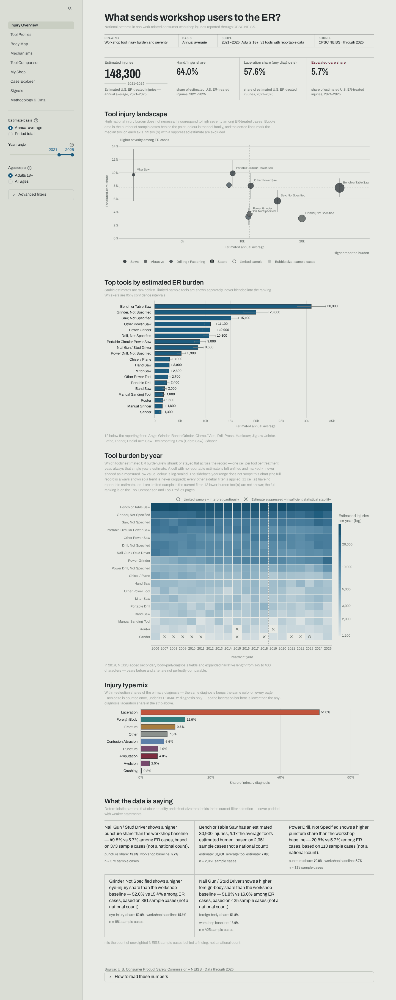

### 2. Tool Profiles

**What does one tool's injury pattern look like?**

A single tool in depth: which body regions it involves, how its burden has moved over time with
confidence bands, its diagnosis and mechanism mix, and real de-identified ER narratives behind
the numbers.

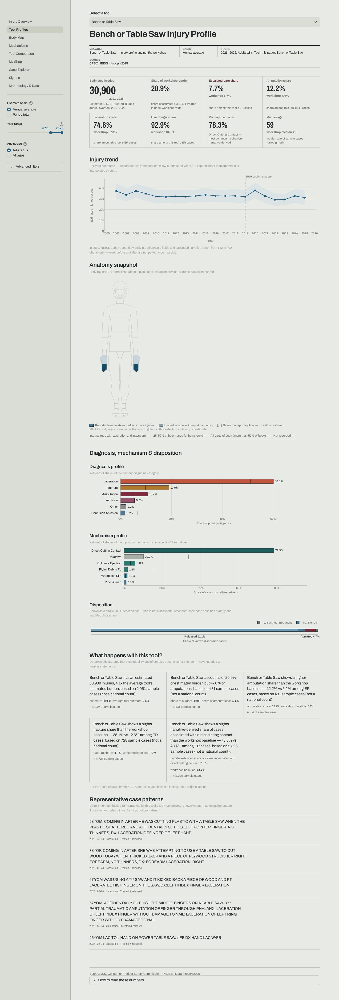

### 3. Body Map

**Where on the body do workshop injuries happen?**

The signature visual: a matte 3D figure you can turn in your hands: a drafted orthographic
plate, not a person. Drag to orbit, scroll or pinch to zoom, and use the **Whole body** / **Hand**
buttons to jump between the full figure and a close-up of the hand.

Picking a tool is the one moment the camera does analytical work. The regions that tool does not
reach fade toward the sheet first, and the whole figure is held for a beat with only the hotspots
lit, so the answer is readable on the body before anything moves. Only then does the camera turn
and lean into the most-affected area, and pulse it once. If you are already zoomed in it cross-fades
in place and flies straight to the new hotspot with no detour back out; clearing the selection
returns you. Hovering never moves the camera, and nothing in the scene animates on its own.

Two channels carry the data, and they are deliberately independent. **Ink density is the
measure**: the more injuries associated with a region, the darker its fill and the further it
stands proud of the surface, tapering back to flush at every seam so a lifted region reads as
relief rather than tearing away from its neighbours. **Linework is confidence**, and it only
appears where there is something to qualify: a region with a reportable estimate carries no
contour at all (its fill is what says "region"), while a **dashed** construction line marks a
limited sample, and a dashed line over bare sheet means the estimate is below the reporting
floor. A region with no recorded cases is different again, and says so: it keeps only the
faintest solid hairline, because "nothing was recorded here" is settled rather than provisional.
So a region can say "large, but provisional" without either statement borrowing the other's
channel, and "we do not have a reliable number here" recedes instead of being the loudest thing
on the figure. Hovering a region surfaces its
estimate, sample size and any suppression label, and clicking it filters everything beneath:
diagnosis and mechanism mix, top tools, representative narratives, and the body-part × tool
matrix.

NEISS records fingers as **one** body-part category. The figure models five individual fingers,
but all five always share a single value; the data cannot say which finger was injured, and the
map says so on the page rather than inventing a split.

The 3D viewer loads Three.js from a CDN (jsDelivr) when the page opens. Offline, in a browser
without WebGL, or with the **Flat body map** toggle on, the page shows the flat, keyboard-accessible
front/back 2D map instead, with the same data and the same click-to-filter behaviour.

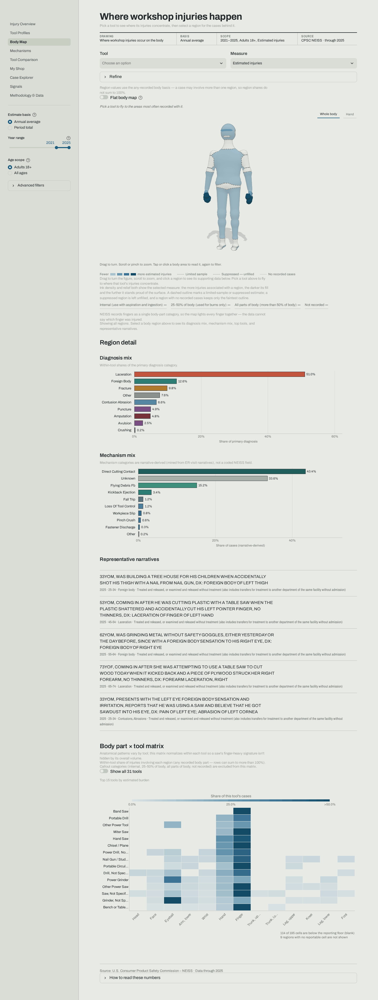

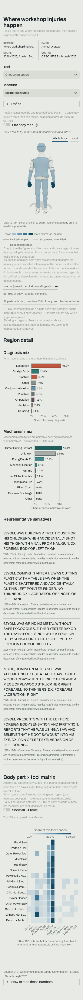

### 4. Mechanisms

**How do workshop injuries happen?**

Mechanism categories mined from free-text ER narratives by a deterministic classifier, plus a
five-stage Tool → Mechanism → Body → Diagnosis → Disposition pathway. Flows below the CPSC
reportability floor are pooled into an explicit combined band rather than quietly dropped.

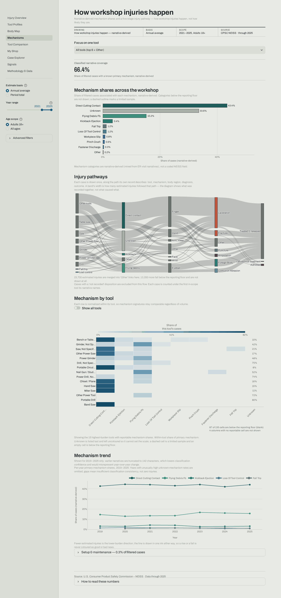

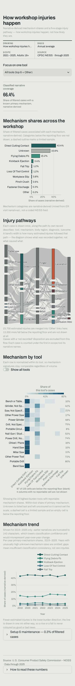

### 5. Tool Comparison

**How do these tools actually differ?**

Two to six tools side by side. The fingerprint matrix shows each tool's diagnosis and severity
mix as a log-ratio against the all-workshop baseline, so a tool's signature is visible
independently of how common it is.

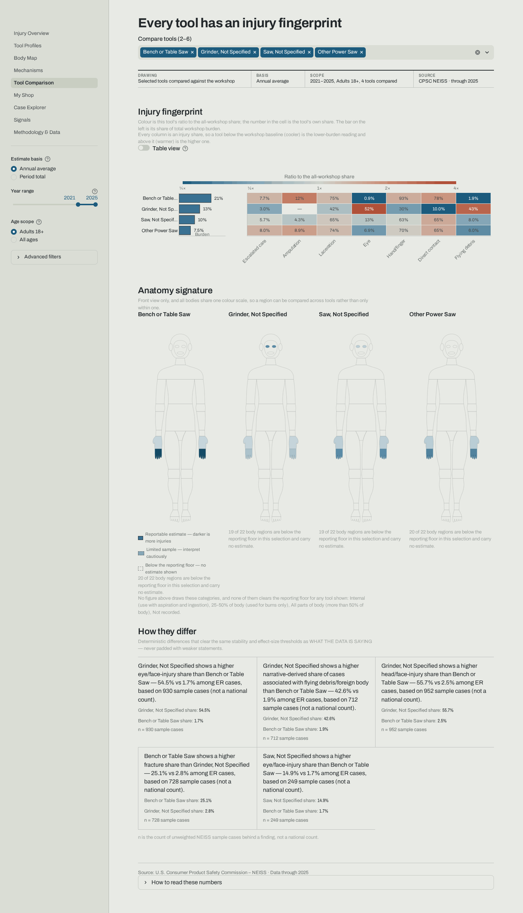

### 6. My Shop

**What should I be mindful of in my shop?**

Pick the tools you own and get a profile scoped to them: which body regions those tools involve
most, and what to watch for, stated as associations measured among ER cases, with the
no-exposure-denominator caveat shown on every render.

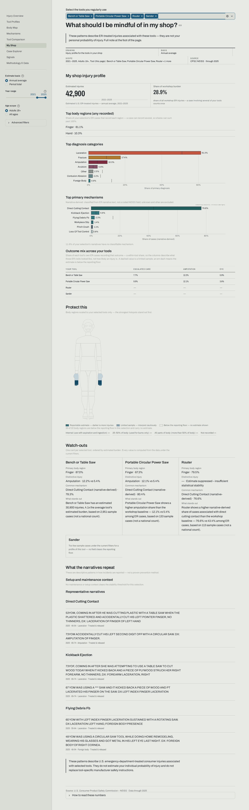

### 7. Case Explorer

**What actually happened in these cases?**

Full-text search across individual de-identified ER narratives, with matched terms highlighted
and every case showing its year, age band, diagnosis and disposition. This is the raw material
every mechanism category is derived from.

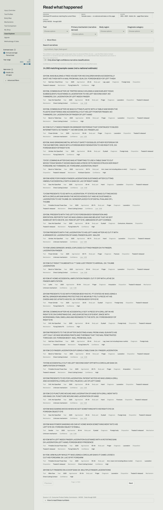

### 8. Signals

**What stands out across every tool?**

One ranked cross-cutting feed of the findings that clear the stability and effect-size gates,
tiered by strength. Every card carries what differs, its magnitude, the baseline it was compared
against, and the sample size behind it.

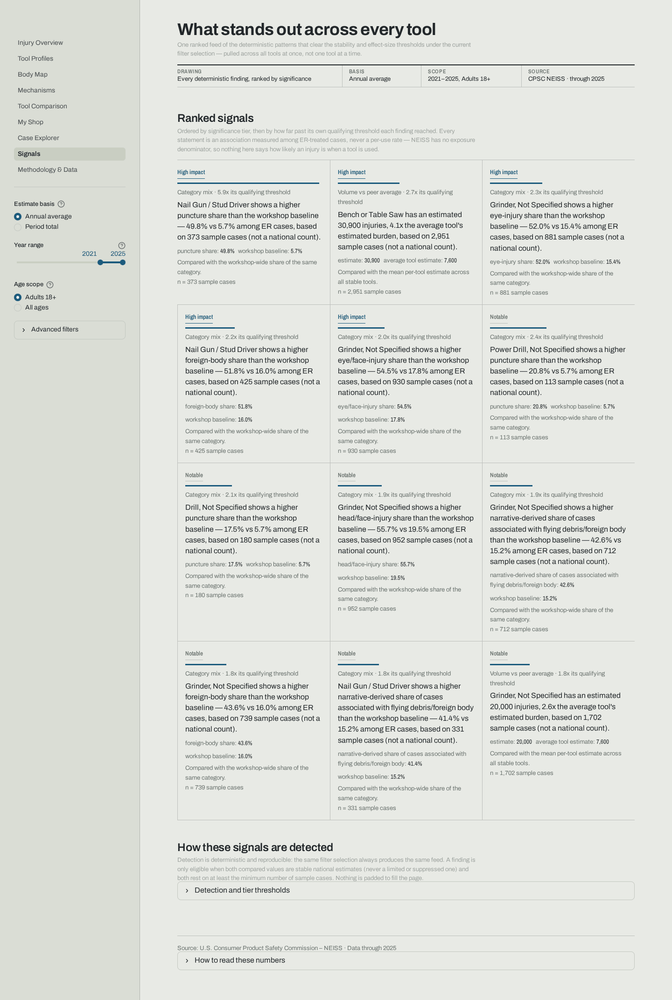

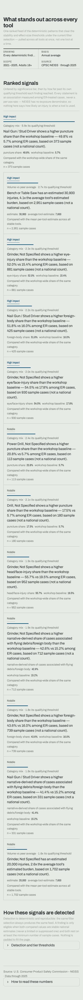

### 9. Methodology & Data

**How was every number on this site produced?**

The transparency backstop: survey-weighted methodology, the reconciliation against CPSC's own
Query Builder, a data-lineage diagram, measured classifier accuracy, and a live data-quality
panel naming every pipeline check that did not pass.

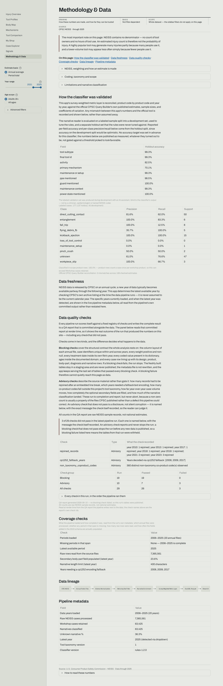

## Why this exists

The hard problem in this dataset is restraint. NEISS carries survey weights, strata and PSUs, so a
national estimate is a statistical claim with a variance attached, and it carries no exposure
denominator, so the comparative-hazard question every woodworker arrives with cannot honestly be
answered from it. There is no count of tool owners and no count of hours at the saw, so an injury
total can never be turned into a per-use rate, however badly a reader wants one.

Building this meant deciding what the product refuses to say, and then enforcing those refusals in
code rather than in a disclaimer: burden and severity kept structurally separate, estimates
suppressed or flagged by coefficient of variation at a single call site, comparisons gated on
non-overlapping confidence intervals, and a vocabulary scanner that fails CI if the words "risk",
"danger" or "safer" reach a user-facing string. The reconciliation against CPSC's own Query Builder
exists for the same reason: an estimate nobody checked against the publisher is just a number.

---

The code in this repository is licensed under the [MIT License](LICENSE). The NEISS data itself is
U.S. public domain, published by CPSC (see [`docs/data-distribution.md`](docs/data-distribution.md)).


